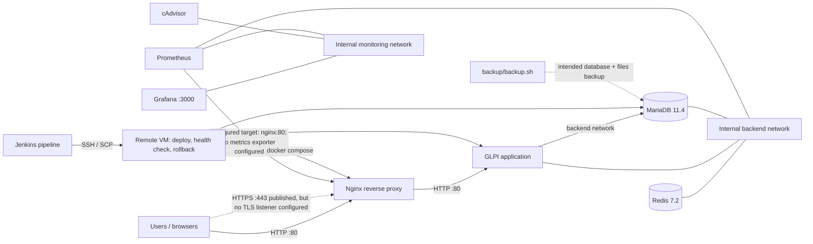

# Addosser Ticketing Stack

A Docker Compose deployment of GLPI for IT service management / ticketing, backed by MariaDB and fronted by Nginx. The repository also includes Redis, Prometheus, Grafana, cAdvisor, Jenkins deployment/rollback scripts, and a backup script.

## Architecture



The Compose file defines three networks: `frontend` for Nginx and GLPI, `backend` (internal) for GLPI, MariaDB, Redis, and Prometheus, and `monitoring` (internal) for Prometheus, Grafana, and cAdvisor. MariaDB data, GLPI data, Redis data, and monitoring data use named volumes. Redis is deployed but this repository does not show GLPI configured to use it. Likewise, Prometheus's configured Nginx target currently has no metrics exporter, as noted in `prometheus/prometheus.yml`.

## Services and repository layout

| Path | Purpose |
| --- | --- |
| `docker-compose.yml` | GLPI, MariaDB, Redis, Nginx, Prometheus, Grafana, and cAdvisor services, networks, volumes, health checks, and ports. |
| `nginx/conf.d/glpi.conf` | HTTP reverse proxy from Nginx to the `glpi` service. |
| `prometheus/prometheus.yml` | Prometheus scrape interval and current Nginx target placeholder. |
| `scripts/deploy.sh` | On-host deployment: records the prior commit, fetches `origin/main`, and starts updated Compose services. |
| `scripts/rollback.sh` | Restores the commit recorded in `.last_good_commit` and restarts the stack. |
| `scripts/healthcheck.sh` | Polls the local HTTP endpoint after deployment or rollback. |
| `backup/backup.sh` | Backup routine for database, uploaded files, configuration, optional remote sync, and retention. See the compatibility caveat below. |
| `Jenkinsfile` | Validates/pulls Compose images, runs basic checks, deploys or rolls back via SSH, then checks health. |
| `.gitignore` | Ignores `.env`, `.last_good_commit`, and log files. |

## Run locally

Requirements: Docker Engine with the Compose plugin, and a `.env` file in the repository root. No `.env.example` is currently provided. Create `.env` with these required variables, replacing each placeholder with a unique, strong value:

```dotenv
MYSQL_ROOT_PASSWORD=<strong-unique-root-password>
MYSQL_DATABASE=glpi
MYSQL_USER=glpi
MYSQL_PASSWORD=<strong-unique-database-password>
REDIS_PASSWORD=<strong-unique-redis-password>
```

Then validate and start the services:

```sh
docker compose config
docker compose pull
docker compose up -d
```

Nginx publishes host ports `80` and `443`; Grafana publishes `3000`. The checked-in Nginx configuration only listens on port `80` and does not configure TLS, so the `443` mapping alone does not provide HTTPS. Configure TLS and firewall access before exposing this stack to a network. GLPI is also mounted at `/var/www/html/glpi` as a persistent volume.

The Compose file mounts `./mariadb/init` into MariaDB, but that directory is not present in the repository's top-level tree. Create it if initialization scripts are required. The `GLPI_IMAGE` default is `glpi/glpi:11.0-nightly`; set `GLPI_IMAGE` to a tested stable release for production.

## Deployment and operations

The Jenkins pipeline uses the configured Jenkins SSH credential `glpi-vm-ssh-key` and a host/repository directory hardcoded in `Jenkinsfile`. The remote deploy script fetches and resets to `origin/main`; rollback resets to the saved pre-deploy commit. Review these settings and the target branch before adapting the pipeline. Health checks probe `http://localhost:80/` on the remote host.

**Backup caveat:** `backup/backup.sh` does not match the current Compose stack: it expects a container named `glpi-db` and volumes named `glpi-stack_glpi_files` and `glpi-stack_glpi_config`, while the current Compose file defines `glpi-mariadb` and a `glpi_data` volume. Verify and update the backup targets before relying on backups or restoring data. The script also copies `.env` into the backup directory, so protect and encrypt backup storage.

## Security review

This is a static review of the repository configuration and scripts, not a live penetration test or a dependency/image vulnerability scan. GitHub security-alert data was not available during this review, so this should not be read as confirmation that there are no known dependency vulnerabilities.

| Priority | Finding | Evidence and recommended action |
| --- | --- | --- |
| High | HTTPS is not configured although host port `443` is published. | `docker-compose.yml` publishes `443:443`, but `nginx/conf.d/glpi.conf` only has `listen 80`. Configure TLS (and HTTP-to-HTTPS redirection) or do not publish 443; do not send credentials or ticket data over untrusted HTTP. |
| High | Grafana is published directly on host port `3000`. | `docker-compose.yml` has `3000:3000`. Restrict it to a trusted management network/VPN or bind it to localhost behind an authenticated TLS proxy, and set a strong unique admin password. |
| High | Mutable or prerelease image references can change without a code review. | `docker-compose.yml` defaults GLPI to `glpi/glpi:11.0-nightly` and uses `latest` for Prometheus and Grafana. Prefer supported stable versions and, for production, pin verified image digests and update them deliberately. |
| Medium | cAdvisor is granted broad read-only host filesystem/runtime mounts. | `docker-compose.yml` mounts `/`, `/var/run`, `/sys`, `/var/lib/docker`, and `/dev/disk` into cAdvisor. Keep this service on a trusted host/network, minimize mounts to those required, and avoid exposing its interface. |
| Medium | Backup implementation appears incompatible with the current service and volume names. | `backup/backup.sh` targets `glpi-db`, `glpi-stack_glpi_files`, and `glpi-stack_glpi_config`; these do not match `docker-compose.yml`. Fix and test backup/restore paths, secure the copied `.env`, and consider avoiding the database password in process arguments (`-p...`). |
| Medium | The Jenkins secret scan is narrow and can miss secrets. | `Jenkinsfile` only greps `*.yml` for a limited pattern; it does not cover all file types or all secret formats. Use a dedicated secret scanner and protect/rotate any credentials found in repository history. |
| Low | Port `443` is mapped without a matching listener, and the Prometheus target has no metrics exporter. | Nginx configuration only listens on `80`; `prometheus/prometheus.yml` itself says the Nginx target is a placeholder until an exporter is added. Configure the intended services/targets and verify them operationally. |

Additional hardening: keep `.env` out of version control and use unique randomly generated passwords; restrict host firewall access to published ports; pin and regularly update images; enable authenticated TLS for administrative interfaces; and test a full backup restore. The checked-in `.gitignore` excludes `.env`, but this alone does not remove secrets already committed.

## Notes on monitoring

The Prometheus configuration scrapes `nginx:80`, but the repository does not define an Nginx metrics exporter, so this target is not currently a valid metrics endpoint. Add and configure an exporter (and then update the scrape target) if Nginx metrics are required. The Compose file does not publish Prometheus itself to the host.
